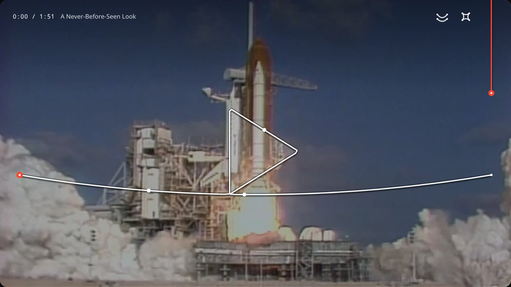
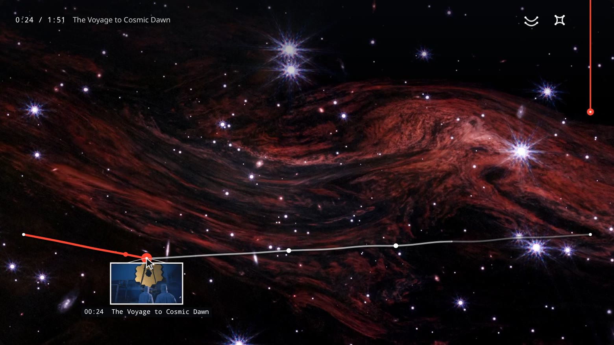

# Red Thread

A Video.js 10 skin where the whole player is one piece of string.

**[Live demo](https://red-thread-skin.vercel.app)** · [the player on its own page](https://red-thread-skin.vercel.app/preview.html) · [55 second video](media/red-thread-demo.mp4) · [at work on my portfolio](https://valeriodonfrancesco.pro/work/red-thread.html)

[](https://red-thread-skin.vercel.app)

- **The timeline is a thread.** Played is red, buffered is white, the rest is faint. Chapters are knots.
- **On pause it draws the play button.** The thread goes slack, rises and folds into a triangle. Click and it snaps tight and rings.
- **You seek by plucking.** Drag the thread and the video follows your hand; let go and it rings like a guitar string. A plain click keeps it tight and the red runs up to the spot. Arrow keys slide the preview along it.
- **The preview hangs from the thread** like a photo on a clothesline, using the media's storyboard track. Move fast and it swings.
- **Captions are two strands** that hang loose when off and pull tight when on. Each caption line is written out with a thread drawn under it.
- **Fullscreen is a thread on four pins.** Click it and four threads reach the corners of the screen, go tight and pull the player open.
- **Volume is a pull cord** in the top corner. Pull down for more, tap to mute.
- **While you watch it almost disappears**: a thin line at the bottom edge that trembles with the sound, and carries a bump along it while the video buffers.



## Use it

The skin is the four files in `src/video/`: `skin.html` (the markup), `skin.css`, `skin.ts` (the Video.js parts it needs) and `red-thread.ts` (the canvas). It needs `@videojs/html` 10.3 and nothing else.

1. Install Video.js for HTML:

   ```sh
   npm install @videojs/html@10.3.0
   ```

2. Copy `src/video/` into your project, for example as `red-thread/`.

3. Put the skin's markup inside a `<video-player>` and replace its placeholder comment with your media:

   ```ts
   import '@videojs/html/video/player';
   import '@videojs/html/media/mux-video'; // or another Video.js media element
   import './red-thread/skin';
   import template from './red-thread/skin.html?raw'; // Vite; with another bundler, paste the markup into your page

   const player = document.createElement('video-player');
   player.setAttribute('poster', 'https://image.mux.com/PLAYBACK_ID/thumbnail.webp');
   player.innerHTML = template.replace(
     '<!-- Add a compatible media component here. -->',
     `<mux-video src="https://stream.mux.com/PLAYBACK_ID.m3u8" playsinline crossorigin>
        <track kind="chapters" srclang="en" src="chapters.vtt" default>
      </mux-video>`
   );
   document.body.append(player);
   ```

   `apps/preview/src/frame/player.ts` is this same code, as the demo runs it, with one precaution for Safari added (see [In Safari](#in-safari)).

### Without a bundler

`npm run build:embed` writes `dist-embed/`: `red-thread.js` (Video.js, the Mux media element and the skin in one module), `red-thread.css` and the language files Video.js loads on demand. Copy the folder to your site, then put the skin's markup inside a `<video-player>`:

```html
<link rel="stylesheet" href="/red-thread/red-thread.css" />
<script type="module" src="/red-thread/red-thread.js"></script>

<video-player poster="poster.jpg">
  <!-- the contents of src/video/skin.html, with this in place of its comment: -->
  <mux-video src="https://stream.mux.com/PLAYBACK_ID.m3u8" playsinline crossorigin></mux-video>
</video-player>
```

My portfolio is a static site and runs the skin this way, with square corners and its own typefaces set through the custom properties below: [valeriodonfrancesco.pro/work/red-thread.html](https://valeriodonfrancesco.pro/work/red-thread.html).

What the thread shows comes from the media:

| On the thread | Where it comes from |
| --- | --- |
| Knots | a `<track kind="chapters">` |
| The hanging preview | a `<track kind="metadata" label="thumbnails">` storyboard; `<mux-video>` adds its own |
| Caption lines | the media's caption or subtitle tracks |

Four custom properties restyle it:

```css
video-player {
  --media-accent-color: #ff4530; /* the thread */
  --media-border-radius: 14px;
  --media-font-family: 'IBM Plex Sans', system-ui, sans-serif;
  --media-mono-font-family: 'IBM Plex Mono', ui-monospace, monospace; /* the time, and the labels on the thread */
}
```

### Keyboard

Every control is a real Video.js element under the drawing, so Tab reaches captions, fullscreen, mute, play and the time slider, each with a focus ring.

| Key | Action |
| --- | --- |
| Space, K | Play or pause |
| ← → | Back or forward 5 seconds |
| J, L | Back or forward 10 seconds |
| ↑ ↓ | Volume |
| M | Mute |
| C | Captions |
| F | Fullscreen |
| 0 to 9, Home, End | Jump along the thread |

### Touch

- The caption and fullscreen buttons are 44 px targets on touch screens; the cord and the thread take a finger anywhere near them.
- Tap the cord's knob to mute, pull it to set the volume. On an iPhone, where the browser leaves loudness to the hardware buttons, the cord is the mute switch: down for sound, up for silence.
- Under a finger the thread rises above it and goes tight, so the preview hangs in view instead of under the hand. On a small player the time and the icons step back while it does.
- A finger on the picture scrolls the page, unless it starts on the thread or on the cord.
- While the film plays and the time and icons are away, the first tap on the picture brings them back and the film keeps playing; the next tap pauses. A tap never lands on a button that is not showing.
- An iPhone has no fullscreen for a page's own controls, only Apple's player for the bare video. There the four threads pull the player open to fill the window and the skin stays; Safari's own bar stays too, since a page cannot hide it. Only in a small embedded frame does the handover to Apple's player remain.
- On a player as small as a phone's, caption lines sit under the time and the icons and move up into their place when those are away.

### Reduced motion

With `prefers-reduced-motion: reduce` nothing springs, swings or stretches: the thread and the cord jump to their place, captions appear without the wipe, fullscreen opens without the four threads, and a still ring around the bead stands in for the bump while the video buffers.

### In Safari

Two things came up while testing in Safari (26 on an iPhone simulator, 27 on a Mac). Neither is in the skin: both are in the layers under it, Video.js 10.3 and hls.js 1.7, and a bare `<video-player>` with `<mux-video>` shows them too. Both leave a film that has loaded standing at its first frame.

- **Play with nothing loaded.** This film's sound begins 21 ms after its picture, and hls.js steps over that with a seek when a film that should be playing has not moved yet. With `preload="none"`, or a quick hand, the seek can land before Safari has its first frame; on a Mac Safari then reports the film as playing and leaves it at 0.12 s. The demo makes the first play wait for the first data: `holdFirstPlay` in `apps/preview/src/frame/player.ts`.
- **An address that arrives late.** If `src` reaches `<mux-video>` after its `<track>` children have loaded (a page that asks nothing of the video host until the first gesture), the element adds its storyboard track and, with it, puts every other track back into the video. Safari sets a track that is put back to loading and never finishes it, and it holds a film at its first frame while a track is loading. Put the storyboard track in the markup yourself, empty, and the element only fills in its address: `<track kind="metadata" label="thumbnails" default data-storyboard>`.

`tools/ios-check/` has what found them: a check in Safari on an iPhone simulator with real touches, one in Safari on a Mac (both run from the Actions tab), and a small lab that serves the player layer by layer.

## How it is built

`src/video/skin.html` is a normal Video.js 10 skin: `media-container`, the real `media-play-button`, `media-mute-button`, `media-captions-button`, `media-fullscreen-button`, `media-time-slider`, `media-time`, hotkeys, error dialog and status announcer. Those elements keep the player operable by keyboard and assistive technology.

`src/video/red-thread.ts` defines `<red-thread>`, one canvas over the picture. Every frame it reads the player store (`currentTime`, `duration`, `paused`, `buffered`, `waiting`, `volume`, `muted`, `chaptersCues`, `thumbnailsTrack`, `subtitlesShowing`, `isFullscreen`) and draws the thread; pointer gestures call the store's actions (`play`, `pause`, `seek`, `setVolume`, `setMuted`, `requestFullscreen`). It has no dependencies beyond `@videojs/html`.

`src/video/skin.css` styles the real controls and exposes `--media-accent-color`, `--media-border-radius`, `--media-font-family` and `--media-mono-font-family`.

## Develop

```sh
npm install
npm run dev
```

The workbench in `apps/preview/` plays the demo video with chapters, captions and a storyboard. Change the media in `apps/preview/src/frame/player.ts`.

```sh
npm run typecheck
npm run build
```

## Deploy

The demo is on Vercel and follows this repository: a push to `main` publishes it. To put the workbench on a host of your own, `npm run deploy` publishes it to Vercel, Netlify or Cloudflare Pages.

## Credits

- Made by [Valerio Donfrancesco](https://valeriodonfrancesco.pro) for the Video.js Skins Design Challenge by Contra and Mux.
- Built on [Video.js 10](https://videojs.org) and started from `videojs skin create` (see `skin.json`).
- The demo video is the official trailer of [Cosmic Dawn: The Untold Story of the James Webb Space Telescope](https://plus.nasa.gov/video/cosmic-dawn-the-untold-story-of-the-james-webb-space-telescope/), a NASA+ documentary, from the public download of NASA's Scientific Visualization Studio, hosted on Mux (playback ID `8izx3zG35t1ZxSvbjcNmkrAawz9Jhe0172VdCUge25vE`) with captions generated by Mux. Credit: NASA's Goddard Space Flight Center, which does not endorse this project. The video is not part of this repository.

## License

[Apache License 2.0](LICENSE). See [NOTICE](NOTICE).
